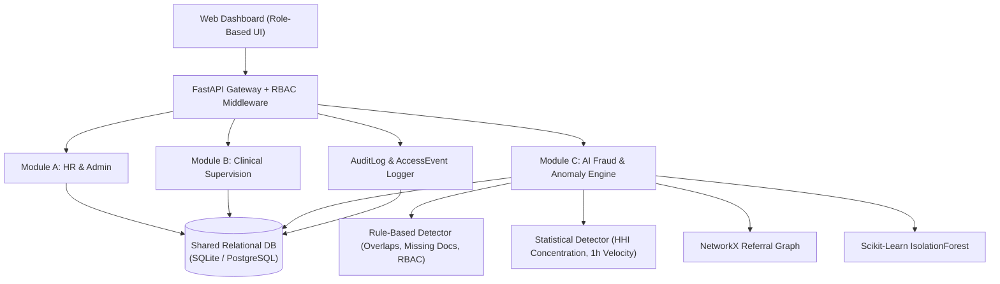
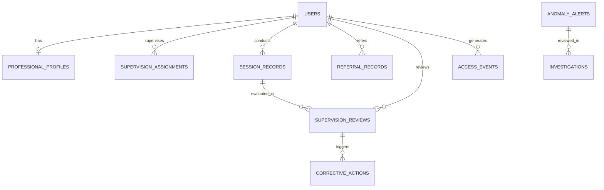

# ARAMANA Governance — Architecture & Design

## 1. System Architecture Diagram

## 2. Database Entity Relationship Diagram (ERD)

## 3. Role & Permission Matrix (RBAC)

| Resource / Endpoint | `platform_admin` | `hr_admin` | `clinical_supervisor` | `therapist` | `compliance_reviewer` |
| :--- | :---: | :---: | :---: | :---: | :---: |
| HR Profiles & Contracts | Read/Write | Read/Write | — | — | Read |
| Org Assignments | Read/Write | Read/Write | — | — | — |
| Clinical Session Notes | **Blocked (Logged)** | **Blocked (Logged)** | Assigned Only | Own Only | — |
| Supervision Reviews | Read | — | Read/Write | — | Read |
| Fraud Alerts & Scan | Read/Scan | — | Read/Investigate | — | Read/Scan/Investigate |
| Audit Logs | Read | — | — | — | Read |
